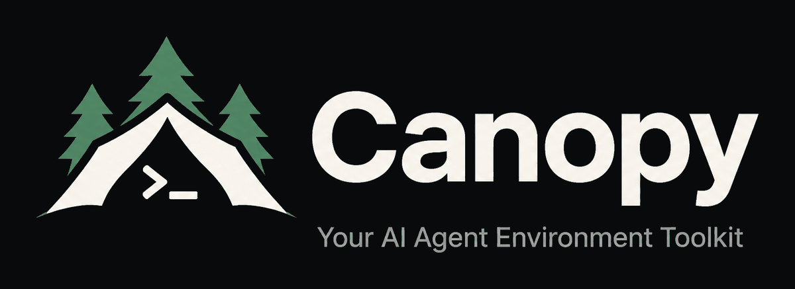

<p align="center">
  
</p>

<p align="center">
  My toolbox for developing with Claude Code on a server.
</p>

<p align="center">
  
  
  
  
</p>

---

While building a project, I ran [Claude Code](https://claude.com/claude-code) on a server and talked to it
from my phone. Getting that machine ready took a pile of small manual steps: clone the repos, sync my notes,
set permissions, log in, pair Telegram, keep sessions alive. Then I did it all again on the next server.

canopy is those steps pulled out of that project into their own repo, so setting up the tools is one command
instead of an afternoon. It is a toolbox, not a framework: it runs stock Claude Code, prescribes no workflow,
and doesn't care how you organize your docs or notes. The defaults in [`config/`](config/) are just what
worked for me; override any of them locally.

## What it sets up

- 📦 **Tools**: Claude Code (pinned version), Node LTS, Bun, gh, git, tmux, ripgrep, jq on Ubuntu 24.04
- 🔁 **Repos and notes**: your repos are cloned once into `~/projects`; an optional notes repo (the "vault") is
  pulled and pushed every 5 minutes. Restarts and rebuilds keep everything in the `/root` volume
- 💬 **Telegram** (optional): talk to the agent from your phone; remote control is on as well
- 🔄 **Fresh sessions on request**: ask for a new session and get a Telegram ping when it's ready;
  the agent leaves a handoff that the new session loads automatically
- 🔔 **Usage-limit alerts**: Telegram warning at 80% of the 5-hour / weekly limit and a notice when it runs out,
  sent by the shell, so they arrive even when the agent can't answer
- 🧩 **Linear and Figma** (optional): MCP servers, added only if you list them
- 💾 **Small-disk friendly**: npm / yarn / bun caches stay off the volume; `doctor.sh` warns at 85% disk
- 🛡️ **Safe by default**: `auto` mode with explicit allow / ask / deny rules, SSH by key only
- 🩺 **`doctor.sh`**: one ✔/✘ line per component, with a hint for every ✘

Only two things are required: an SSH key and a GitHub token. Everything else is opt-in.

## Quick start

The `canopy` CLI runs on your laptop (Windows, macOS, Linux; Node 20.12+) and sets up the server for you.
You need a VPS with Docker and SSH access by key; to try it first, use `target: docker` on your own machine.

```bash
git clone https://github.com/<you>/canopy && cd canopy
npm install && npm run build && npm link     # puts `canopy` on your PATH

mkdir ~/my-env && cd ~/my-env
canopy init            # a few questions -> canopy.yaml, .env (with where-to-get comments), .gitignore
                       # fill in the keys it lists in .env
canopy init --check    # validates the keys against GitHub (and Linear, Telegram if you use them)
canopy up              # uploads to your VPS, builds and starts the container, runs doctor
canopy login           # Claude login, then Telegram and Figma if enabled: no typing on the server
```

If you enabled Telegram, message your bot. Logins and clones live in the `/root` volume and survive restarts.

<details>
<summary><b>Without the CLI</b></summary>

<br>

```bash
cp .env.example .env      # at minimum: AUTHORIZED_KEYS and GH_TOKEN
docker compose up -d
docker compose exec canopy bash -lc doctor.sh
```

Then do the [manual steps](#manual-steps).

</details>

## CLI

Put `canopy.yaml` (no secrets) next to `.env` (secrets only) and run commands from that folder.

```yaml
# canopy.yaml
name: canopy            # compose project, image and volume name
target: ssh             # ssh (your VPS) | docker (this machine) | railway
vps: { host: 1.2.3.4, user: root, port: 22, key: ~/.ssh/id_ed25519 }
vault: you/notes        # optional
repos:
  - you/app
  - { repo: you/api, branch: develop }
channel: telegram       # optional: telegram | none
mcp: [linear, figma]    # optional
```

| Command | What it does |
|---|---|
| `canopy init` | wizard: target, SSH key, vault (can create one), repos, integrations, git author |
| `canopy init --check` | validate `.env` keys against GitHub, Linear and Telegram; values are never printed |
| `canopy login [service]` | log in to Claude, pair Telegram, authorize Figma; `status` shows what is connected |
| `canopy up` | build and start the container, wait for setup, run doctor |
| `canopy down` | stop the container; the `/root` volume is kept |
| `canopy restart` | restart the agent and keep the conversation |
| `canopy fresh` | restart the agent with a clean context |
| `canopy doctor` | ✔/✘ for every part; exit code 1 if anything fails |
| `canopy logs [--agent]` | follow container logs, or watch the agent session read-only |
| `canopy ssh` | open a shell inside the container |
| `canopy add-repo <repo> [--branch]` | add a project and clone it; no image rebuild |
| `canopy remove-repo <repo>` | remove a project; deleting its files in the container is optional |
| `canopy update --claude [version]` | move Claude Code to a version (default: latest), rebuild, run doctor |

### Targets

| `target` | Where it runs | How |
|---|---|---|
| `ssh` (main) | your VPS | uploads the image sources over SSH to `~/canopy-<name>` and runs `docker compose` there; `.env` is uploaded only after you confirm |
| `docker` | this machine | `docker compose` with a compose file generated in `.canopy/`; handy for trying canopy out |
| `railway` | Railway | `railway link` once, then variables (confirmed, sent via stdin), the `/root` volume and `railway up` |

## Configuration

Every variable is documented in [`.env.example`](.env.example).

| Variable | Required | Purpose |
|---|:---:|---|
| `AUTHORIZED_KEYS` | ✔ | SSH public key(s), `;`-separated |
| `GH_TOKEN` | ✔ | GitHub token for clone / push / PRs |
| `REPOS` | | `owner/name,...` cloned into `~/projects/` |
| `VAULT_REPO` | | knowledge vault cloned into `~/vault` and synced |
| `WORKDIR` | | agent working dir; defaults to the first repo |
| `TELEGRAM_BOT_TOKEN` | | enables the Telegram channel |
| `LINEAR_API_KEY` | | adds the Linear MCP server |
| `GIT_NAME` / `GIT_EMAIL` | | defaults to the token's GitHub user |

Any variable can be read from a file instead: `GH_TOKEN_FILE=/run/secrets/gh_token` (Docker secrets).

**Base and local.** Defaults live in [`config/`](config/). Your changes go into `/root/canopy.local/`
(`CLAUDE.local.md`, `settings.local.json`) and are merged on every start; local permission rules are added to
the base ones, not replacing them. See [`examples/`](examples/).
Skills in the vault's `.claude/skills/` are linked into `~/.claude/skills` one by one.

`PROFILE` (`personal` | `project`) only describes intent in V1; both behave the same.

### Your workflow stays yours

The agent rules in `config/` are a handful of habits that saved me trouble (one command per call, tests are
not weakened, ask before guessing, leave a handoff). Anything about *how* you work, like spec stages, ticket
flow or review checklists, belongs in your own skills: put them in `~/vault/.claude/skills/` and canopy links
them into every session.

## Manual steps

**With the CLI**, one command walks you through all of them and skips what is already done:

```bash
canopy login            # or: canopy login claude | telegram | figma | status
```

- **Claude**: opens the agent session; log in, trust the folder, detach with `Ctrl+B` `D`.
- **Telegram** (if `channel: telegram`): DM your bot, paste the 6-character code it replies with. canopy approves it and switches the bot
  to allowlist itself (no agent turn, no tokens).
- **Figma** (add `figma` to `mcp:`): open the printed link, click Allow, then paste the `localhost` address the
  browser fails to load. That address carries the one-time code back to the server.

<details>
<summary><b>Without the CLI</b></summary>

<br>

Connect with `ssh -p 2222 root@localhost`, then:

1. **Claude**: `tmux attach -t claude`, follow the login prompt, detach with `Ctrl+B` `D`.
2. **Telegram**: DM your bot, it replies with a code; run `telegram-pair.sh <code>`.
3. **Figma or another OAuth MCP server**: `claude mcp add -s user -t http figma https://mcp.figma.com/mcp`,
   then `claude mcp login figma --no-browser` and follow it.

</details>

## Deploy on a VPS

Any Linux server with Docker Engine (with the compose plugin) and SSH access by key.

1. In `canopy.yaml`: `target: ssh` and `vps: { host, user, port, key }`.
2. `canopy up`: uploads the image sources and config to `~/canopy-<name>`, asks before uploading `.env`
   (stored there with `chmod 600`), builds and starts the container.
3. `canopy login`, `canopy doctor`, `canopy ssh` and the rest run over the same SSH connection.

The container also publishes its own sshd on port 2222. The CLI doesn't need it, so you can keep that port
closed in your firewall and use it only if you want to connect from elsewhere.

<details>
<summary><b>Railway instead of a VPS</b></summary>

<br>

**With the CLI**: `target: railway` and `ssh: { host, port, key }` (the TCP proxy), then `canopy up`.
Railway CLI can't create a TCP proxy: add it once in the dashboard (service -> Settings -> Networking ->
TCP Proxy -> port 22).

**Without the CLI**:

1. New project → *Deploy from GitHub repo* → your fork of canopy.
2. Add a **Volume** mounted at `/root`. Without it, logins and clones are lost on every redeploy.
3. **Variables**: paste your `.env` into the raw editor.
4. **Settings → Networking → TCP Proxy** on port `22`, then `ssh -p <port> root@<host>`.
5. Do the [manual steps](#manual-steps).

The SSH host key is stored in the volume, so redeploys don't trigger "host key changed" warnings.

</details>

## Security

- **No `--dangerously-skip-permissions`.** It disables every check, `deny` included, so one prompt injection
  from a web page, file or ticket could do anything the container can. canopy uses `auto` mode with
  [explicit rules](config/settings.base.json): routine commands run, force-pushes ask, destructive commands,
  `sudo` and reading `~/.ssh` or `.env` files are denied.
- **Minimal tokens.** Fine-grained `GH_TOKEN` scoped to your repos and vault (Contents + Pull requests),
  one Telegram bot per environment.
- **Know where secrets live.** `env_file` keeps them out of compose files and git, but `docker inspect` still
  shows them; use `*_FILE` with Docker secrets if that matters. Inside the container the agent's shell can read
  them: `deny` rules prevent accidents, they are not a sandbox.

## Roadmap

- [x] **V1**: reproducible Claude Code environment
- [ ] **V2**: other agents
- [ ] **V3**: more integrations (Slack)
- [ ] **V4**: several environments managed together
